# 微观化学演示台

把分子构型、晶胞与堆积方式变成可以旋转、拆解、逐步讲解的课堂模型。

Windows x64 · 中文界面 · 内置 RDKit · 核心功能离线运行

> **可以免费下载，但使用前必须获得权利人的书面许可；禁止商用。** 非商业学习、学校课堂和研究测试也须先申请。本项目不是自由使用的开源软件。完整条款见 [LICENSE.md](LICENSE.md)，申请方法见 [使用许可申请](docs/PERMISSION.md)。

[下载 Windows 软件](https://github.com/B-TQ/microchem-desktop/releases/tag/v5.0.0-public.1) · [申请非商业使用许可](https://github.com/B-TQ/microchem-desktop/issues/new?template=permission.yml)

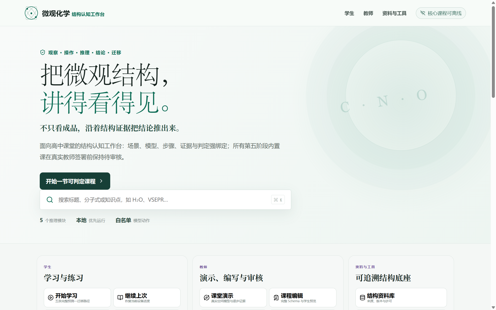

## 下载、申请、启动

1. 打开 [正式 Release 下载页](https://github.com/B-TQ/microchem-desktop/releases/tag/v5.0.0-public.1)，下载 Windows x64 便携 ZIP 或安装 EXE，并同时下载 `SHA256SUMS.txt`。仓库的绿色 Code → Download ZIP 只下载说明与演示，**不包含软件**。
2. 按 [申请说明](docs/PERMISSION.md) 建立 Issue，等待权利人明确批准。下载成功不代表已经获得使用许可。
3. 便携版：完整解压 ZIP，再打开 `Microchem-Desktop` 文件夹中的 `微观化学演示台.exe`。不要在压缩软件里直接运行，不要只复制一个 EXE。安装版：运行安装程序并按提示安装。
4. 首次运行会显示许可提醒；确认按钮只记录你的声明，不代替权利人的批准。获准使用后，从首页选择课程、模板或结构资料库。

本次分发版本为 **5.0.0 / 发布修订 public.1**。应用内部仍显示 5.0.0；发布修订用于区分已内置新晶胞库、元素标记和公开分发目录的包，避免误用旧 5.0.0 包。请以正式 Release 附件为准；尚未建立 Release 时，仓库本身没有软件安装包。

### 下载文件怎么选？

| 文件 | 用途 |
| --- | --- |
| `Microchem-Desktop-5.0.0-public.1-win-x64.zip` | 便携版，完整解压后运行 |
| `Microchem-Desktop-5.0.0-public.1-win-x64.exe` | 安装版，按安装向导操作 |
| `SHA256SUMS.txt` | 校验官方附件是否被修改 |

首次安装或解压建议留出约 1 GB 空间。需要 Windows 10/11 x64、支持 WebGL 的显卡与驱动；不是手机应用，也不提供本次未经验证的 macOS/Linux 构建。没有代码签名，可能提示“未知发布者”；请核对来源与校验值，不要关闭安全防护。详细说明见 [安装与故障处理](docs/INSTALL.md)。

## 真实操作演示

以下素材来自实际运行的 Windows 桌面程序，不是设计稿或 AI 生成图。使用全新独立演示数据目录，只输入示例化学结构；不包含真实学生记录、桌面背景、浏览器账号、试用访问码或文件选择器中的私人路径。动图由程序实际操作期间的连续截图转制，具体采集方式见 [演示说明](docs/DEMO.md)。

### 1. 讲解分子构型：从电子对到 CH₄、NH₃、H₂O

首页搜索或选择“CH₄、NH₃、H₂O：电子对排布到分子构型”模板。点击“播放 / 暂停”，用“上一步 / 下一步”控制讲解节奏，也可以直接点左侧步骤。鼠标拖动旋转模型，滚轮缩放。

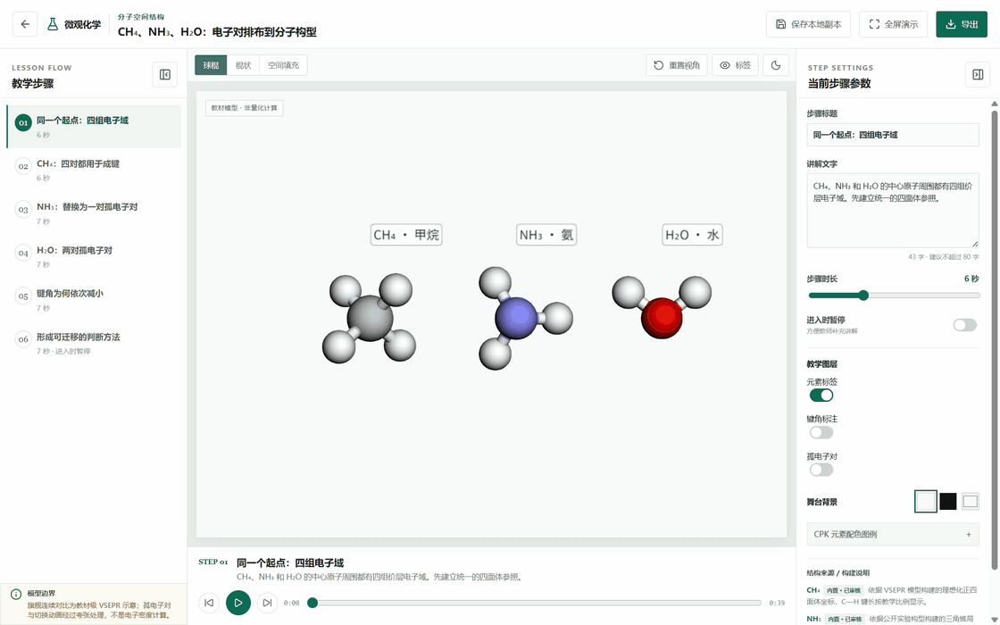

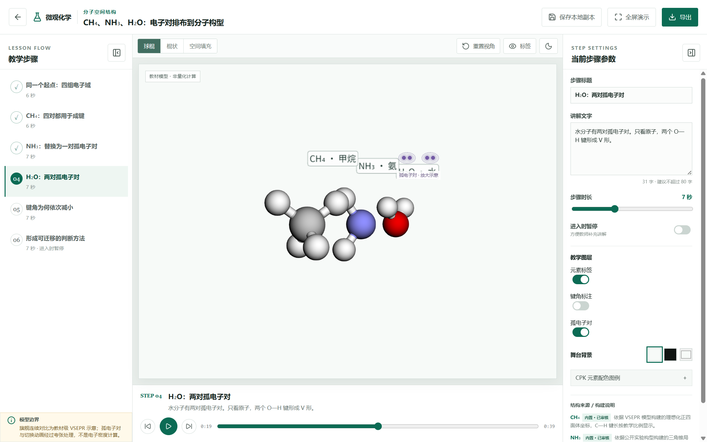

课堂演示可点击“全屏演示”；模板模式支持 `Space` 播放/暂停、`← / →` 切步、`R` 重置、`L` 标签、`Esc` 退出演示布局。桌面菜单“视图 → 课堂全屏”或 `F11` 控制整个窗口全屏，两者不是同一个开关。

### 2. 看实体相切球：把 ABC 堆积一层层搭出来

首页进入晶体堆积模块，选择 FCC 相关场景。点击“添加一层”查看 ABC 层序，再切换观察视角并拖动旋转。实体球用于解释空间占据和接触关系，不只是二维圆点示意。

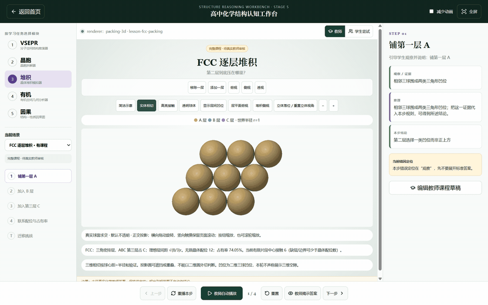

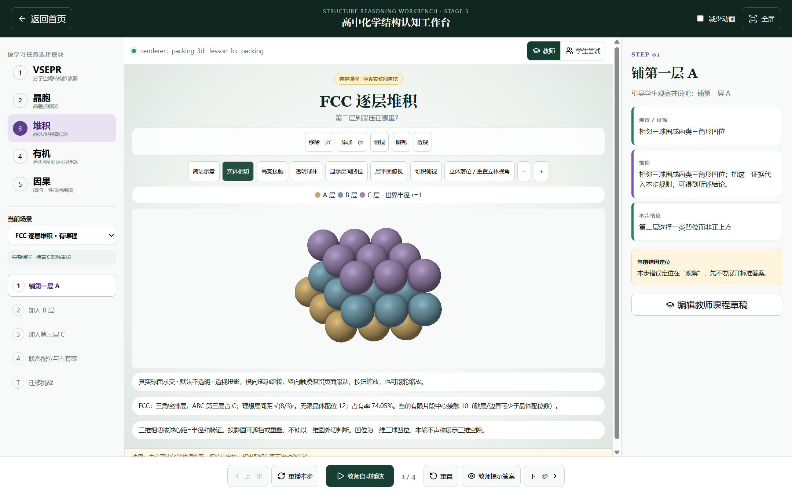

模型对应的教学步骤会展示观察、证据、推理与结论。没有已编课程的结构只提供自由探索，不会套用其他物质的课程答案。

### 3. 浏览晶胞：查 NaCl，显示元素，再切超胞

首页打开“结构资料库 → 晶胞浏览”。在左侧搜索 `NaCl`，选择结构，在模型工具栏切换 `1×1×1 / 2×2×2` 超胞；拖动旋转，勾选或取消“球上元素标记”，选择位点查看占位信息。

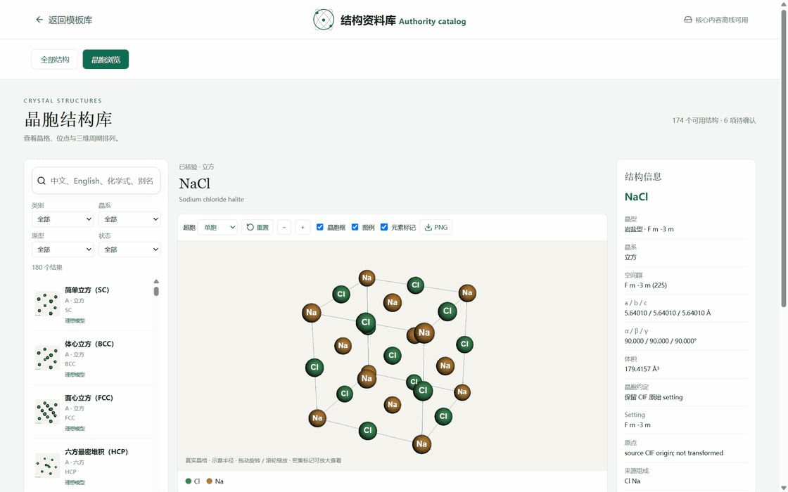

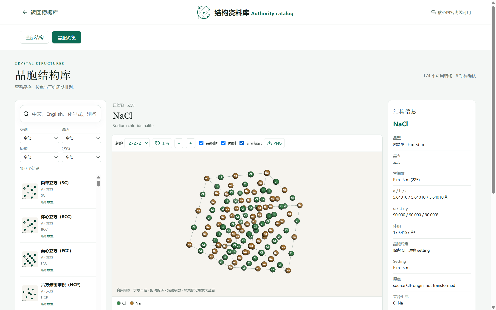

当前晶胞库有 **174 个可用结构与 6 项待确认候选**。其中 170 个可用结构来自真实 CIF，4 个是明确标注的本地理想母结构。待确认条目不伪装成可查看的实验三维结构。

右侧保留空间群、晶格常数、来源、论文与模型限制。`已核验` 是机器数据核验，不等于教师已审核；有缺氢、无序、部分占位等情况时，应阅读限制说明。

### 4. 同一化学式，不混成同一个晶型

在晶胞搜索框输入 `ZnS`，可以看到不同晶型分别列出。选择条目后，核对右侧晶系、空间群和来源，再开始讲解。

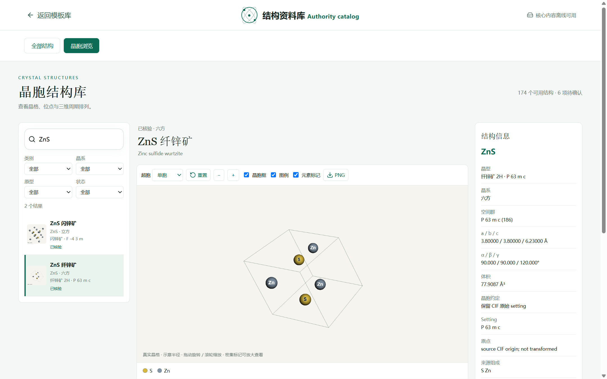

这也适用于分子式检索：输入 `C₂H₆O` 并不意味着唯一得到乙醇；本地词典会列出乙醇、二甲醚等明确候选，须先选定结构。

### 5. 输入二维结构，检查后生成合理三维构象

首页点击“创建结构”。在 SMILES 输入框输入示例 `CCO`，点击“检查结构”，查看分子式与诊断，再点击“生成三维构象”。也可使用本地二维编辑器或导入 MOL/SDF。

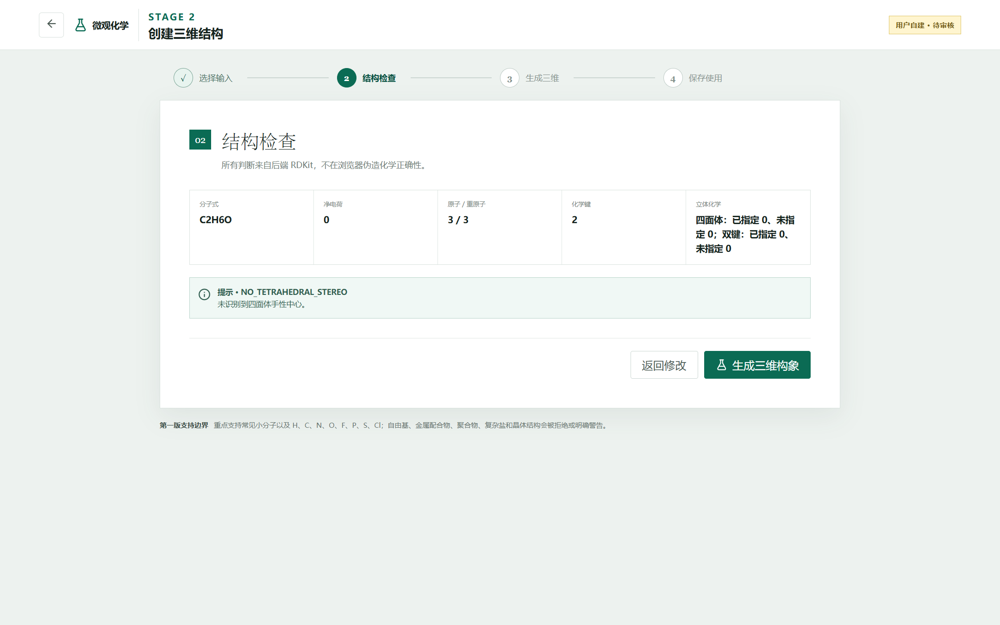

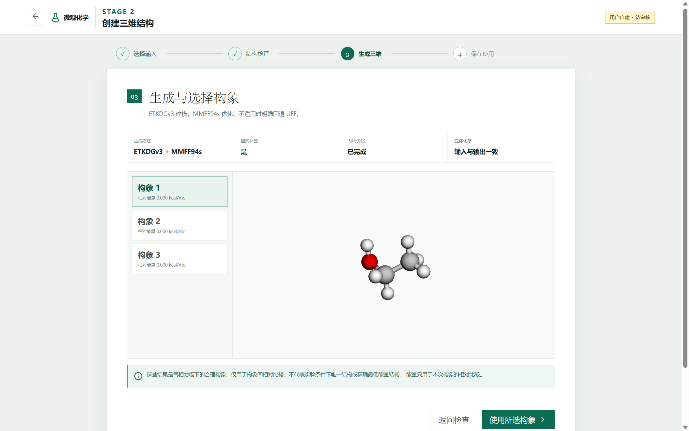

生成结果是 ETKDGv3 与力场优化得到的合理构象，**不是唯一实验结构**。发现价态、连接或立体化学问题时应先处理诊断；不合法结构不会直接生成。自建结构与教学模板保持“用户自建 / 待审核”标记。

### 6. 在内置二维编辑器里画结构

“创建结构 → 绘制二维结构”打开随包 Ketcher。可以在简洁与高级模式间切换；完成后仍须经过结构检查。编辑器资源内置，核心流程不依赖打开外部网页。

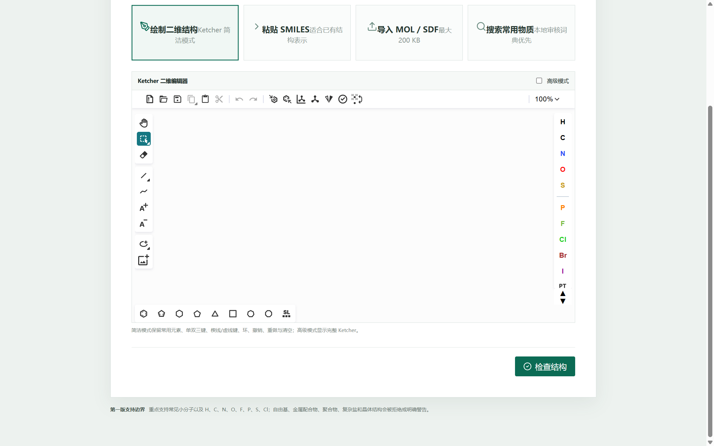

### 7. 导出真正的课堂素材

在教学模板中点击“导出”：可选择 PNG、完整动画 WebM 或教学素材包。PNG 默认 1920×1080，可调整背景；WebM 是否可用取决于设备的录制能力。

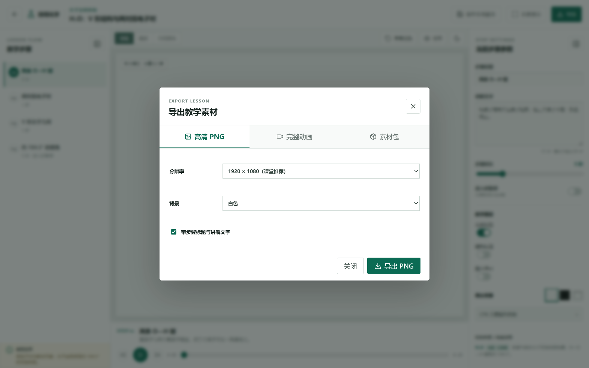

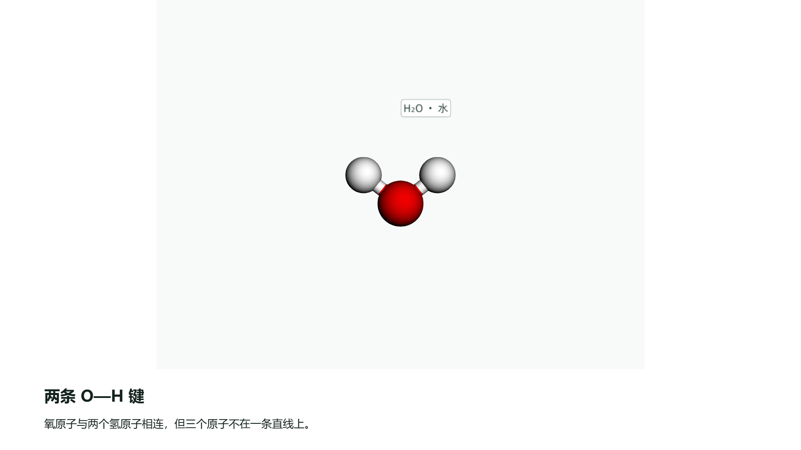

另附 [应用实际导出的水分子 WebM](docs/media/14-water-animation.webm)，可下载播放。GitHub 的 README 不保证直接内嵌播放本地视频，因此主要操作采用可直接显示的 GIF。

导出的原创图片、动画和教学素材仍受使用许可限制；允许导出不代表允许商用、出售或随意再分发。

### 8. 学生模式：先预测，再用证据修正

推理课程可切换学生视角。学生填写结构化答案，查看反馈，逐级使用提示，最后进行迁移与复习；解释文字不冒充可自动精确评分的自由文本答案。

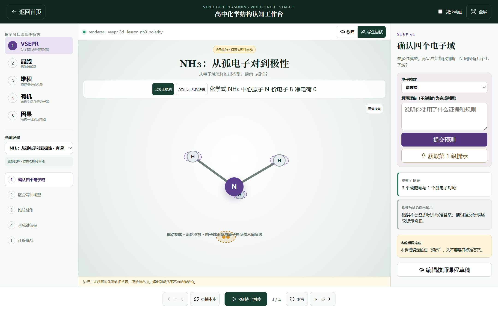

判定区分正确、部分正确、错误和超出范围；借助答案完成不会记作独立掌握。课程和模型都保留边界说明，不建议未经教师核对就作为正式考试评分依据。

## 离线运行与本地记录

桌面版内置前端、结构资源、Python 与 RDKit 服务，核心教学、二维检查和三维生成无需另装 Node/Python，也无需自己启动网页服务器。只有主动打开来源网页等行为需要联网。

有 D 盘且目录可写时，公开分发版默认使用 `D:\MicrochemDesktop\Data`；否则回退到系统应用数据目录下的 `MicrochemDesktop`。学习记录、草稿和日志保存在使用者自己的电脑，不随程序包分发，不自动上传。本版没有在线账号、云同步、遥测或自动更新。

“文件 → 备份学习记录”导出 JSON；“文件 → 恢复学习记录”合并恢复，同名记录会被覆盖。升级或更换设备前先备份。备份可能包含你输入的私人内容，**不要把它上传到公开 Issue**。

## 许可申请与问题反馈

- 使用许可：按 [申请说明](docs/PERMISSION.md) 提交非商业用途申请，等明确书面批准后再使用。
- 软件问题：按 [反馈说明](docs/FEEDBACK.md) 提供版本、现象和可复现步骤，只发已脱敏的截图与日志片段。
- 不公开姓名、电话、邮箱、学校/单位详细身份、学生信息、完整学习备份、访问码、令牌或系统用户名。

仓库维护者的 GitHub 账号在平台上可能可见，但本项目材料不包含个人姓名、邮箱、电话或私人账号链接。

## 本仓库包含什么

本仓库用于软件分发说明、操作演示、许可申请和问题反馈。完整原始工程源码、开发历史、教师试用部署配置、学习数据和私人需求文档不在公开仓库内。软件附件发布到 Releases，不放入 Git 提交。

不提供完整工程源码不代表二进制无法被分析；包内前端与第三方组件仍可能按其技术形式被查看。许可条款是权利边界，不是 DRM 或防破解保证。

## 第三方许可

第三方组件、字体和数据库数据按各自许可使用；本项目限制不改写它们的独立授权。详见 [第三方说明](THIRD_PARTY_NOTICES.md) 和随包 `resources/notices`。研究作者姓名等必要的公开学术署名不是本项目维护者的个人资料，依法应保留。

本自定义许可禁止商用并要求事先许可，因此不能称为 OSI 意义的开源许可证。[OSI 定义](https://opensource.org/osd)要求不能限制商业等使用领域。GitHub 公开仓库也受平台查看、Fork 等规则约束，许可中已保留这类平台权利；见 [GitHub 许可说明](https://docs.github.com/en/repositories/managing-your-repositorys-settings-and-features/customizing-your-repository/licensing-a-repository)。
